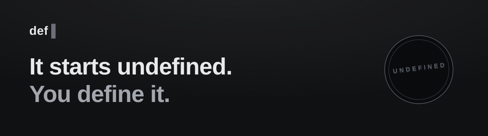

<div align="center">
  <picture>
    <source media="(prefers-color-scheme: dark)" srcset="doc/assets/banner-dark.svg" />
    <source media="(prefers-color-scheme: light)" srcset="doc/assets/banner-light.svg" />
    
  </picture>

  <p><strong>def</strong>——由你定义的应用。<br>
  本仓库 <strong>dsh-mobile</strong> 是它背后的开源移动宿主：一份核心，三部手机，一切在本地。</p>

  <p>
    <a href="https://lixiang9716.github.io/def/">项目主页</a> ·
    <a href="#%E7%8E%B0%E7%8A%B6%E9%80%9F%E8%A7%88">现状速览</a> ·
    <a href="#quickstart">Quickstart</a> ·
    <a href="README.md">English</a>
  </p>
</div>

[English](README.md) | 简体中文

## 这是什么？

dsh-mobile 是 DSH（DeepSeek Harness）生态的**移动宿主**：把上游 DSH agent——桌面端的
Harness 运行时——完整搬上手机，覆盖三个移动平台（Android、iOS、HarmonyOS）。一切都发生在
设备本地：单线程 QuickJS 运行时在进程内承载 Harness 核心，能力网关把每个操作系统的原生服务
收拢到一份狭窄的原语契约之后，UI 是可插拔的 Web Client 而非写死的界面。进程内 shell、插件
市场、真实 LLM 会话、乃至 agent 驱动的插件创作——全部本地完成，没有云端中继。

**为什么存在。** 手机上没有供 agent 立足的 Linux shell 生态，桌面 agent 也无法直接安装到
手机上。基于社区 Fabric 互操作模型，dsh-mobile 证明了一条同构移植路线：上游包在 QuickJS 上
**原样**运行（pin + 校验，绝不改动），一切平台差异都表达为对冻结契约的能力协商——一份核心，
三个宿主。

> 社区独立项目，非 DeepSeek 官方产品。上游生态参考
> [anywhere-labs/dsh-desktop](https://github.com/anywhere-labs/dsh-desktop) 与 DSH
> Community Fabric 草案。

## 现状速览

这里的每条断言都有仓内证据背书——回执在 [doc/e2e-matrix.md](doc/e2e-matrix.md)。

- **三个宿主的完整应用内 agent 会话**——你输入，模型逐 token 流式回答，工具自行执行并渲染
  工具卡，会话扛住 force-stop 并可续聊。
- **真正的应用内 shell**——bash 子集 shell（管道、重定向、coreutils 表面）完全进程内运行。
  如实声明这是模拟：无内核、无 ELF 二进制、无包管理器——并与真实 bash 做过差分测试。
- **创建模式**——一句话描述一个插件：agent 写出来、你批准、当场挂载运行。
- **真实 LLM 流式 + 你自己的密钥（BYOK）**——OpenAI 兼容与 Anthropic 协议端点；密钥存在手机
  keychain 里，绝不进日志；流式传输层经过敌意线缆工况的锤炼。
- **插件市场**——浏览并安装带签名的插件；每次安装都走同一条经验证的原子流水线。
- **UI 即插件**——整个界面可整体替换：官方客户端、紧凑版，或渲染面试点（Lynx）的实验
  面孔。

诚实的边界：没有任何宿主提供真实子进程或 Linux userland（模拟方案试过、已退场）；模拟器没有
电台，相机、麦克风、蓝牙按设备如实协商，部分回执等待真机；后台驻留是 checkpoint/resume，不是
桌面级常驻。

## Quickstart

```sh
git clone https://github.com/Lixiang9716/def
cd dsh-mobile
build/build.sh --list          # 各平台及其工具链需求
build/build.sh android         # sync → compile → 模拟器上的日志验证 e2e
```

- 一份门面驱动所有平台："build" 永远是 **sync → compile → test**——与该平台 CI 完全相同的
  三步。iOS 只能在 macOS 上编译；工具链缺失时响亮失败，点名缺什么、去哪装。
- 手头没有移动端工具链？core CLI 是最便宜的验证载体：`build/build.sh compile core` 构建出
  各平台内嵌的那个 C 宿主。完全没有工具链？[项目主页](https://lixiang9716.github.io/def/)
  用一页诚实的话讲清这个项目是什么。
- 在对应模拟器/仿真器上启动构建出的应用，它会进入交互席——官方 Web Client 由回环 carrier
  服务。

完整门面（CMake 层、closures 门禁、模拟器矩阵）：[BUILD.md](BUILD.md)。运行出问题时：
[doc/troubleshooting.md](doc/troubleshooting.md)。

## 架构一屏

五层，每层一句话：

1. **Presentation**——UI 是 Web Client 插件，经回环 carrier 渲染在系统 WebView 里；宿主不
   写死任何 UI。
2. **Harness 核心**——上游 DSH 运行时在单线程 QuickJS 引擎上原样运行；子进程语义在进程内重新
   实现。
3. **系统实现插件**——小型 JS 插件把网关原语组合成上游服务契约（fs、shell、凭据……）。
4. **能力网关**——一份狭窄、版本化的原语表，带权限检查与审计日志；宿主固定，永远不是插件。
5. **特权层**——薄薄一层原生壳（Swift / Kotlin / ArkTS），持有 entitlements、keychain、
   选择器、通知。

平台差异是能力协商，永远不是代码分支。完整设计：
[doc/ARCHITECTURE.zh.md](doc/ARCHITECTURE.zh.md)；全流程端到端（启动、网关调用、LLM 流式、
安装）：[doc/sequence-diagrams.zh.md](doc/sequence-diagrams.zh.md)。

## 项目状态

下表每个里程碑都已完成且有证据。证明材料——场景日志、verdict 计数、artifact 回执——在
[doc/e2e-matrix.md](doc/e2e-matrix.md)。

| 里程碑 | 现状 |
| --- | --- |
| 契约冻结（原语 + 数据协议） | 已冻结；仅可加性扩展 |
| 运行时与宿主 dsh | 完成 |
| 首个真机会话 | 完成 |
| 插件系统（安装链路、UI 插件化） | 完成 |
| Android 与鸿蒙宿主 | 完成 |
| 设备面（震动、剪贴板、分享、选择器） | 完成 |
| 相机 / 麦克风 / 蓝牙同意面 | iOS 与 Android 完成；鸿蒙等真机 |
| 渲染面客户端（Lynx 试点） | 试点完成 |
| 应用内 shell | 完成，三宿主 |
| iSH 模拟 Linux userland | 已退场——按契约如实答 unavailable |
| 模拟器矩阵（发布级证据网） | 完成 |

## 文档地图

| 当你想…… | 读 |
| --- | --- |
| 理解分层设计与决策依据 | [doc/ARCHITECTURE.zh.md](doc/ARCHITECTURE.zh.md) |
| 端到端看任一流程——启动、网关调用、LLM 流式、安装 | [doc/sequence-diagrams.zh.md](doc/sequence-diagrams.zh.md) |
| 构建某个宿主，或排查构建问题 | [BUILD.zh.md](BUILD.zh.md) |
| 为本宿主写插件 | [doc/plugin-dev.zh.md](doc/plugin-dev.zh.md) |
| 把桌面 DSH 插件移植过来 | [doc/dsh-desktop-plugins.zh.md](doc/dsh-desktop-plugins.zh.md) |
| 核对某条断言背后的证据 | [doc/e2e-matrix.zh.md](doc/e2e-matrix.zh.md) |
| 看测试姿态与加固计划 | [doc/test-coverage.zh.md](doc/test-coverage.zh.md) |
| 排查一次出问题的运行 | [doc/troubleshooting.zh.md](doc/troubleshooting.zh.md) |
| 切一个版本化发布 | [doc/release.zh.md](doc/release.zh.md) |
| 提议改动某个已定决策 | [doc/decisions.md](doc/decisions.md)——先读它 |

## 治理

本仓库由 [govrail](https://github.com/Lixiang9716/govrail) 门禁管理：pre-commit 内容门、
推送前门 DAG、CI 强制（`.github/workflows/gov.yml`）。`main` 受保护：变更经 pull request
落地、`gates` 检查绿后方可合并；提交信息遵循 Angular Conventional Commits
（`type(scope): subject`）。

## License

MIT

## Star History

<picture>
  <source media="(prefers-color-scheme: dark)" srcset="https://api.star-history.com/svg?repos=Lixiang9716/def&type=Date&theme=dark" />
  <source media="(prefers-color-scheme: light)" srcset="https://api.star-history.com/svg?repos=Lixiang9716/def&type=Date" />
  
</picture>
